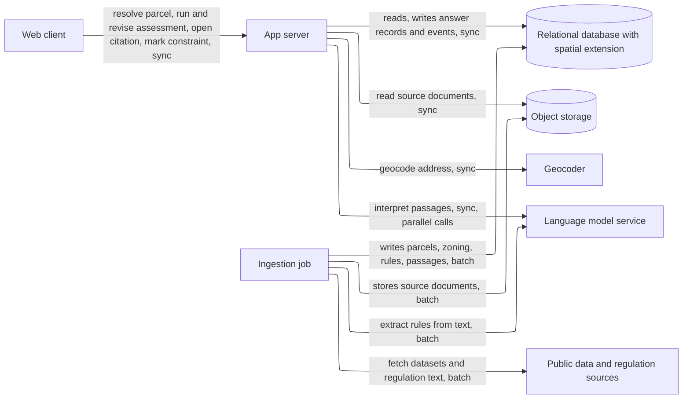
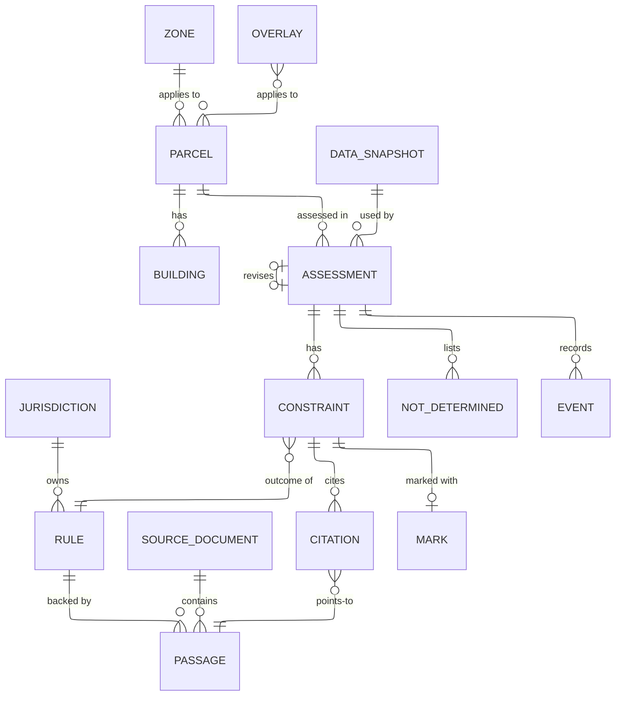
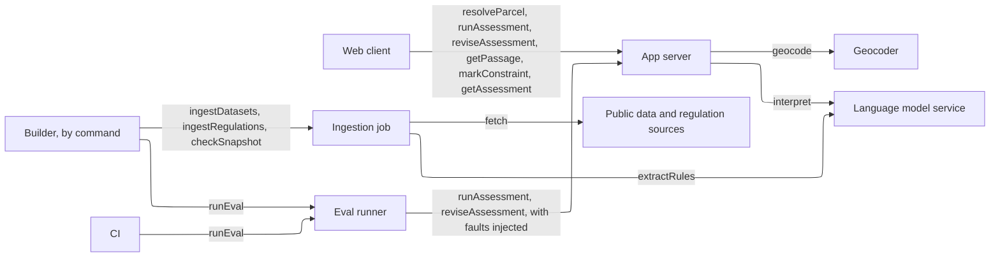

# HIGH_LEVEL_DESIGN.md — Home Building Regulatory Engine

**What this document is.** The parts the system needs and why, sized to the load it actually has. It names kinds of component, not products; `STACK.md` picks the products, except where a requirement fixes one (GC-4a: PostgreSQL, PostGIS, Shapely). How the code is organized inside the app is `ARCHITECTURE.md`. Requirement IDs refer to `REQUIREMENTS.md`; `U§n` and `A-n` refer to `USERS.md`. **[assumed]** marks an answer taken without confirmation (no meeting with Cover is possible); each is listed in §7.

## Summary

- **Load:** about 5 architects now (SC-1), at most about 20 at the horizon (12 months) **[assumed]**. Peak is 5 assessments in flight, about 0.5 completed per second. About 100 assessments a day now. About 20 reads per write. About 2 GB of answer records per year plus about 3 GB of source data.
- **Design:** one web client, one app server, one database with a spatial extension, object storage for the source documents, and an offline ingestion job. Two outside services are called while answering: a geocoder and a language model. Nothing else.
- **Wireframe:** [Assessment screen](https://claude.ai/artifact/BD6AcHx4gZj6Sp5GW1NaFR), clickable: start, loading, several parcels, no match, unsupported, geocoder down, took over 30 s, answer (deterministic and interpreted constraints, ambiguous readings, could-not-determine list, map, project inputs, what changed), out of date, partial answer. The link is private to the owner until shared.
- **Next as it grows:** a stored table of interpretation results, then a second app instance. Triggers are in §5. The language model, not our servers, is what limits speed and cost.
- **Cost:** about $350/month now and about $1,200/month at the horizon, at about $0.08 per assessment. No total budget was given, only CO-1 (interim $0.25 per assessment) (§6).

## 1. Sizing answers

| # | Question | Answer | Source |
|---|---|---|---|
| 1 | Users now, growth, peak | About 5 users now, a small internal group; at most about 20 in 12 months. Peak is all of them asking at once. | SC-1, Requirements Assumption 3; growth **[assumed]** |
| 2 | Read- or write-heavy | Reads dominate: each assessment makes many database reads and writes one answer record plus a few events. The heaviest interaction is running an assessment (many reads, 2–6 model calls). About 20 reads per write. | FR-2, OB-1; ratio **[assumed]** |
| 3 | Data that can never be lost | No money or customer records. Keep: answer records and the confirmed/wrong marks and events (they replay answers and feed KEY_METRICS). Everything else can be rebuilt by re-running ingestion. | OB-1, OB-4, KEY_METRICS |
| 4 | Latency expected | First answer and re-answer p95 ≤ 10 s; map within 3 s of a resolved parcel; geocoder failure reported within 5 s; hard stop at 30 s. See §2. | PF-1, PF-2, PF-3, DE-1, RL-2 |
| 5 | Cost ceiling | No total budget. Median cost per assessment ≤ $0.25 (interim, to be set after the first eval run). | CO-1 |

## 2. Interactions and load

| # | Interaction | R/W | How often | Peak/s | Expected latency | Data touched | Can be lost? | Source |
|---|---|---|---|---|---|---|---|---|
| I-1 | Resolve an address or APN to a parcel (shows map) | R | 10/user/day **[assumed]** | 0.2 | map ≤ 3 s, failure told ≤ 5 s | Parcel, Building, geocoder | — | FR-1.1–1.5, PF-3, DE-1 |
| I-2 | Run an assessment (first answer) | R + W | 10/user/day **[assumed]** | 0.5 | p95 ≤ 10 s including I-1 | Parcel, Zone, Overlay, Rule, Passage, Assessment | Keep | FR-2, PF-1 |
| I-3 | Change project inputs and re-answer | R + W | 10/user/day **[assumed]** | 0.5 | p95 ≤ 10 s | Same, plus the previous Assessment | Keep | FR-3, PF-2 |
| I-4 | Open a citation | R | 5 per assessment **[assumed]** | 2.5 | feels instant, ≤ 1 s **[assumed]** | Passage, SourceDocument, Event | Keep (event) | FR-2.3, OB-4 |
| I-5 | Mark a constraint confirmed or wrong | W | 3 per assessment **[assumed]** | 1.5 | ≤ 1 s **[assumed]** | Mark, Event | Keep | FR-2.10, OB-4 |
| I-6 | Ingest datasets and regulation text (system, by hand) | W | on demand, at least once per snapshot | — | minutes to hours, never in a request | Parcel, Zone, Overlay, Building, Rule, Passage, SourceDocument, DataSnapshot | Rebuildable | DE-2, VR-1 |
| I-7 | Run the eval suite (system, by hand or CI) | R | a few times a day while building | — | minutes | Assessment, fixtures | Results file kept | EV-3, VR-2, RL-1 |

**Arithmetic.**
- *Rate.* 5 users × 20 assessments (10 first answers, 10 re-answers) = 100 assessments/day now. The active window is 8 h = 28,800 s, so the average is 100 ÷ 28,800 ≈ 0.003/s. The average is irrelevant; the peak is all 5 users asking within the same 10 s, which is 5 in flight, or 5 ÷ 10 s = 0.5 completed/s. At the horizon, 20 users × 20 = 400/day and a peak of 10 in flight = 1/s.
- *Citations and marks.* 5 opens plus 3 marks per assessment is about 8 small requests per assessment. At the peak that is about 4/s for a few seconds. They are single indexed reads or writes.
- *Reads to writes.* Each assessment runs about 10–20 database reads (parcel, zone, overlays, rules, passages) and 1 record write plus about 8 event or mark writes over its life, so roughly 20:1 by queries, and about 1:1 by user actions.
- *Storage, records.* About 50 KB per answer record (constraints, citations, derivations, timings) × 100/day × 365 = 1.8 GB/year ≈ 2 GB now; 400/day gives about 7 GB/year at the horizon.
- *Storage, source data.* Assumed about 1 million parcel and building polygons for the City × about 3 KB = about 3 GB; rule fragments and passages under 100 MB; stored source documents under 1 GB. Total under 15 GB at the horizon. The real parcel count is an open item.
- *Outside calls per assessment.* Geocoder: 1 on the first answer only. Language model: about 2–6 calls (one per interpreted constraint or group of passages) **[assumed]** at 3–10 s each, made in parallel. At about $0.02 a call this is about $0.08 an assessment **[assumed]**, inside CO-1.

**How the 10 s of PF-1 is split.** `REQUIREMENTS.md` leaves the split to this document. The language model is the largest and least certain stage; everything else runs on our own data.

| Stage | Budget (p95) | Notes |
|---|---|---|
| Geocode and resolve parcel (I-1) | 2 s | Map is shown as soon as this ends, so PF-3 (3 s) holds. Failure is reported at 5 s (DE-1). |
| Load parcel, zone, overlays, rules | 0.5 s | Spatial and indexed reads. |
| Evaluate deterministic rules | 0.5 s | Geometry work in the app server. These constraints do not wait on the model. |
| Find passages for interpreted rules | 0.5 s | Text search inside the database. |
| Interpret passages (model, calls in parallel) | 6 s | The tight stage. Calls run side by side, so the stage costs the slowest call, not the sum. |
| Assemble and write the answer record | 0.5 s | |
| **Total** | **10 s** | No margin. If the model stage overruns in the first prototype, the options are a faster model, fewer or shorter calls, or reuse of earlier interpretations (§5). |

For a re-answer (I-3) there is no geocoding, so 8 s remain. Interpreted constraints whose inputs did not change are taken from the previous answer record instead of being asked again.

Peak is 0.5 assessments/s now and 1/s at the horizon. One app server handles hundreds of simple requests per second, so our own compute has over 100× headroom. The pace is set by the model service (3–10 s per call, plus any rate limit), not by the servers. One database handles thousands of simple queries per second; this needs tens.

## 3. Core entities

| Entity | What it is | Key attributes | Relations | Durability | Growth |
|---|---|---|---|---|---|
| Parcel | A residential lot in the City | APN, address, outline, lot area | has Buildings; in one Zone; subject to Overlays | Rebuildable | about 1M rows, fixed per snapshot |
| Building | An existing structure | outline, footprint | belongs to a Parcel | Rebuildable | about 1M rows |
| Zone | A zoning designation | code, area outline | applies to Parcels | Rebuildable | thousands |
| Overlay | An overlay or specific plan | name, area outline, source | applies to Parcels | Rebuildable | hundreds |
| Jurisdiction | The city or county that owns rules | id, name | owns Rules and sources | Rebuildable | 1 now (CH-2) |
| Rule | One rule in the rule set | topic, kind (numeric or prose), building types it covers, jurisdiction | has Passages | Rebuildable, versioned | tens |
| SourceDocument | A stored copy of a code or overlay document | title, date, location, licence, real or mock | has Passages | Rebuildable, versioned | tens |
| Passage | A citable piece of a source | document, section, text, stable id | belongs to a SourceDocument; backs Rules and Citations | Rebuildable, versioned | thousands |
| DataSnapshot | A dated copy of the data used | id, date, per-source real or mock tag | referenced by Assessments | Keep | a few |
| Assessment | The full result for one parcel, building type and inputs | inputs, snapshot, model and prompt versions, timings, cost, created | for a Parcel; revises another Assessment; has Constraints | Keep | about 36k/year now; 150k/year at the horizon |
| Constraint | One rule's outcome inside an Assessment | rule, value, units, building type, label, confidence, derivation, stable id | has Citations; may have a Mark | Keep | about 8 per Assessment |
| NotDetermined | A rule the engine could not resolve | rule, reason | belongs to an Assessment | Keep | about 2 per Assessment |
| Citation | Link from a Constraint to a Passage | passage, order | Constraint to Passage | Keep | about 2 per Constraint |
| Mark | Confirmed or wrong on a Constraint | value, time | one current per Constraint | Keep | one per marked Constraint |
| Event | A recorded user action | type (citation opened, input changed, mark set), answer id, time | belongs to an Assessment | Keep | about 8 per Assessment |

**Access patterns**

| Read | Entities combined | How | At this scale |
|---|---|---|---|
| I-1 find a parcel by APN | Parcel | exact match on APN | needs an index |
| I-1 find a parcel from a geocoded point | Parcel, Building | point inside outline | needs a different kind of store: a spatial index, which the spatial extension in GC-4a provides |
| I-2 zone and overlays of a parcel | Parcel, Zone, Overlay | overlap of outlines | needs a spatial index; about 1M polygons is well within one database |
| I-2 setback and lot dimensions | Parcel outline | geometry calculation | done in app code with Shapely (GC-4a), not in the database |
| I-2 rules for a zone and building type | Rule, Jurisdiction | filter | needs an index |
| I-2 passages for an interpreted rule | Rule, Passage | text relevance over thousands of passages | fine as a query using the database's own text search; a separate search index only if retrieval fails (§5) |
| I-3 previous answer for the change summary | Assessment, Constraint | by answer id, set difference | fine as a query |
| I-4 passage and source link | Passage, SourceDocument | by id | fine as a query |
| KEY_METRICS: parcels assessed per week, wrong-mark share | Assessment, Constraint, Mark, Event | count distinct, group by week | fine as a query at under 150k rows a year |

Nothing needs precomputing: the heaviest live query is two spatial lookups over about 1M polygons with an index, a few milliseconds each.

## 4. API operations

Grouped by the component that **serves** each operation, with who **calls** it. Routes are sketches; exact contracts are `ARCHITECTURE.md`'s.

### 4.1 App server

| Operation | Called by | Input | Output | R/W | Latency class | Sync / async | Serves |
|---|---|---|---|---|---|---|---|
| `resolveParcel` — `POST /parcels/resolve` | Web client, Eval runner | address or APN | one parcel with outline and buildings; or candidates; or "no match"; or "unsupported" with reason; or a named error | R | ≤ 3 s for the map, error ≤ 5 s | sync | I-1, FR-1.1–1.5, DE-1, GC-6 |
| `runAssessment` — `POST /assessments` | Web client, Eval runner | parcel id, building type, project inputs | Assessment: constraints, ambiguous readings, not-determined list, snapshot date and flags (old, mock), answer id | R + W (answer record) | ≤ 10 s | sync | I-2, FR-2.1–2.9, PF-1 |
| `reviseAssessment` — `POST /assessments/{id}/revisions` | Web client, Eval runner | previous answer id, changed inputs | new Assessment plus the change summary against the previous one | R + W | ≤ 10 s | sync | I-3, FR-3.1–3.5, PF-2 |
| `getPassage` — `GET /passages/{id}` | Web client | passage id, answer id | source name, section, passage text, link to the document | R | ≤ 1 s | sync; records a citation-open event | I-4, FR-2.3, OB-4 |
| `markConstraint` — `PUT /constraints/{id}/mark` | Web client | confirmed, wrong, or cleared | the current mark | W | ≤ 1 s | sync; records the event | I-5, FR-2.10, OB-4 |
| `getAssessment` — `GET /assessments/{id}` | Web client, Eval runner | answer id | the stored Assessment | R | ≤ 1 s | sync | CH-3, OB-1 replay, EV-3 |

**Inside the app server (no caller):**

| Work | Trigger | Does | Serves |
|---|---|---|---|
| Record request timing and cost | every request | stores elapsed time by stage and model and cloud cost with the answer record | OB-2, OB-3 |
| Enforce the 30 s stop | every request | ends a request at 30 s with an error that names the stage still running | RL-2 |
| Flag old and mock data | every answer | marks the answer when the snapshot is older than 30 days or any datum is mock | DE-6, VR-8 |

### 4.2 Ingestion job

Runs by hand on the builder's command, never inside a request (the stage budget in §2 has no room for it).

| Operation | Called by | Input | Output | R/W | Latency class | Sync / async | Serves |
|---|---|---|---|---|---|---|---|
| `ingestDatasets` | Builder (command) | dataset locations | Parcels, buildings, zones, overlays loaded; a new DataSnapshot with real or mock tags | W | minutes | batch | I-6, DE-2, GC-7, VR-8 |
| `ingestRegulations` | Builder (command) | regulation documents | stored SourceDocuments, split into Passages with stable ids; Rules with numeric parameters where the text is a table or number | W | minutes to hours | batch | I-6, VR-1, CH-1, CH-2 |
| `checkSnapshot` | Builder (command) | snapshot id | counts and a list of missing data; licence entry per source | R | seconds | batch | GC-9, DE-2 |

### 4.3 Eval runner

| Operation | Called by | Input | Output | R/W | Latency class | Sync / async | Serves |
|---|---|---|---|---|---|---|---|
| `runEval` | Builder, CI | fixtures; options for model off, injected faults, repeat count | a results file with correctness, timing, cost and fault results | R (writes the results file) | minutes | batch | I-7, EV-1–EV-4, VR-2, VR-3, RL-1 |

### 4.4 External services

| Operation | Called by | Input | Output | Latency class | Serves |
|---|---|---|---|---|---|
| `geocode` | App server (`resolveParcel`) | address text | coordinates and candidate matches | ≤ 2 s; a failure is reported at 5 s | FR-1.1, DE-1 |
| `interpret` | App server (`runAssessment`, `reviseAssessment`) | passages, parcel facts, project inputs | a value, the readings, which passages support it | 3–10 s per call, in parallel | FR-2.5, FR-2.7, DE-3 |
| `extractRules` | Ingestion job (`ingestRegulations`) | passage text | candidate numeric rules for the builder to check | seconds per passage | CH-1 |
| `fetch` | Ingestion job | dataset or document location | files | minutes | DE-2, GC-7 |

## 5. Components

### Web client

**Why it exists:** the architect works on screens (U§4), and the confirmed/wrong marks and citation opens that KEY_METRICS counts happen here. **Holds / does:** shows the screens below; keeps the previous answer on screen and marks it out of date while a revision is pending (FR-3.4, RL-3); draws the parcel outline and buildings itself from the geometry it is given, so no map tile service is needed. **Provided by platform:** static file hosting and a CDN, if the host offers them. **Wireframe:** [Assessment screen](https://claude.ai/artifact/BD6AcHx4gZj6Sp5GW1NaFR). **Screens** (one page with these states):
- **Start an assessment:** address or APN box, building type (single-family home, ADU, guest house), and an Assess button. Empty state explains what she will get.
- **Loading:** shows "resolved the parcel" as soon as it is done, with the map, then "reading the rules". States that a request ends in an answer or an error within 30 s.
- **Several parcels match / no match / unsupported / geocoder down / took over 30 s:** each is a named message. Several matches show candidates and no assessment until one is chosen. Errors say which stage failed and offer retry.
- **Answer:** resolved parcel (address and APN, snapshot date), scope notice (7 rules, not the full regulations, no verdict), deterministic constraints and interpreted constraints in separate blocks, each with value, building type, label, confidence, a citation, a derivation and confirmed/wrong buttons; ambiguous readings apart from verified constraints; the could-not-determine list with reasons; map; project inputs (structure, bedrooms, bathrooms, footprint); a "what changed" block after a revision.
- **Banners on the answer:** out of date (while updating or after a failure), partial answer (model unavailable), old data (snapshot over 30 days), mock data in use.

### App server

**Why it exists:** it runs the six operations in §4.1; one server is enough because peak is 0.5 to 1 assessment/s against hundreds/s of capacity (§2). **Holds / does:** resolves parcels; evaluates deterministic rules with no model in the path (VR-2); calls the model in parallel for interpreted rules; assembles the answer with citations, labels and confidence; writes the answer record, timings and cost; computes the change summary; names the failed or slow stage in any error (RL-1, RL-2). It is a single deployable with clear internal modules. **Provided by platform:** TLS, process restarts and log collection if the host offers them. Its request timeout must exceed 30 s (RL-2); some serverless gateways cap requests below that, so `STACK.md` must check this.

### Relational database with a spatial extension

**Why it exists:** parcel and zone lookups need spatial queries and everything else is joined, filtered, indexed rows (§3); GC-4a fixes PostgreSQL and PostGIS. **Holds:** all entities in §3 including answer records, marks and events. Passage text search uses the database's own text search. **Provided by platform:** automated daily backups with tested restore. Answer records and marks are "keep", not "never lose": a day of loss would cost replays and some metrics, not customer data, so no point-in-time recovery is added.

### Object storage

**Why it exists:** stored copies of the code and overlay documents are what a citation opens (VR-1), and files do not belong in the database. **Holds:** source documents, eval results files. **Provided by platform:** durability and access control.

### Ingestion job

**Why it exists:** loading datasets and reading hundreds of pages of regulation cannot fit in a 10 s request, and DE-2 needs every answer to name the snapshot it used. **Holds / does:** I-6 above; run by hand, one machine, no queue. **Provided by platform:** no. It is the part that grows with jurisdictions (CH-5), see the table below.

### Geocoder (external)

**Why it exists:** turns an address into coordinates (FR-1.1). GC-5 says it may be on GCP. A failure is reported within 5 s and no parcel is guessed (DE-1). APN input skips it.

### Language model service (external)

**Why it exists:** interpreted constraints depend on reading prose (U§5 UC-1, A-5). It is the slowest and most expensive box: 3–10 s per call and about $0.08 an assessment **[assumed]**. If it fails, deterministic constraints are still returned and interpreted ones are listed as not determined with reason "interpretation unavailable" (DE-3).

### Public data and regulation sources (external)

**Why it exists:** the origin of parcel, zoning and regulation data. Only the ingestion job calls them, so a request never waits on a city website. If ZIMAS can only be queried live, that changes (§7).

**What to add next**

The first thing to break is the model stage, then availability. The path beyond one city (CH-5) is shown last for the architecture diagram.

| Next piece | What breaks first | Add when (measurable) |
|---|---|---|
| A stored table of interpretation results, reused when the rule and its inputs are unchanged (a table in the same database, not a cache service) | Model calls dominate latency and cost: 6 of the 10 s and most of the cost | Answer p95 above 10 s (PF-1) or median cost above CO-1 in the eval run |
| Second app instance behind a load balancer | One instance means a restart or deploy interrupts everyone | More than 20 simultaneous users, or Cover asks for availability during working hours |
| Separate search index | The database's text search returns the wrong passages | Cited passage supports the value in under 90% of eval cases (VR-5) after tuning the ranking |
| Queue and workers for ingestion, one pipeline per jurisdiction | One machine takes too long to ingest LA County or other cities | A full ingestion of one jurisdiction takes over 4 hours, or a second jurisdiction is added (LI-5, CH-2) |
| Read replica | Reads saturate the database | Database CPU stays above 70% from reads after indexing |

Not needed at this scale and not planned: cache service, CDN beyond what the host provides, persistent connections (the screen updates when a request returns), sharding.

## 6. Cost envelope

| Component | Now | At horizon |
|---|---|---|
| App server | about $30 | about $30–60 |
| Database with spatial extension (about 20 GB, backups) | about $50 | about $100 |
| Object storage | under $1 | under $1 |
| Geocoder | about $15 | about $60 |
| Language model: 100/day × 30 × about $0.08 | about $250 | 400/day: about $1,000 |
| Logs, eval runs, extras | about $10–40 | about $60 |
| **Total** | **about $350/month** | **about $1,200/month — no total budget given; per assessment about $0.08 against the CO-1 interim $0.25** |

The proof of concept itself (one week, a small team, eval runs) will cost a small fraction of the "now" column. The model is about three quarters of the total, which is why §5 puts reuse of interpretations first. At the CO-1 ceiling the monthly bill would be about 3× the figures above. Exact prices are in `STACK.md`.

## 7. Open questions and upstream fixes

| Item | Why it matters | Resolved by |
|---|---|---|
| **[assumed]** 5 users now, 20 at the horizon, 10 parcels and 10 re-answers per user per day | Sizes the load and the cost | Cover, or usage after launch; KEY_METRICS "parcels assessed per week" |
| **[assumed]** 2–6 model calls per assessment, 3–10 s each, about $0.02 a call | The 6 s model stage and CO-1 rest on it | First prototype run; sets CO-1 and PF-1's real margin |
| **[assumed]** about 1M parcels and buildings in the City | Sizes the database | Count from the dataset (open item 1 in `REQUIREMENTS.md`) |
| Whether ZIMAS or city data can only be queried live | A live call in the request path adds time and a failure case; the stage budget has no spare 2 s | `REQUIREMENTS.md` open item 3; if live-only, add a stage and re-split the budget |
| Platform request timeout versus the 30 s stop | Some hosts cut requests before 30 s | `STACK.md` |
| Upstream fix: add a functional row that the parcel and map appear as soon as the parcel is resolved, before the assessment finishes | The wireframe and the stage budget rely on it; PF-3 only times the map | `REQUIREMENTS.md` FR-1.5 |
| Upstream fix: RL-1 and RL-2 should say an error names the failed or slow stage | The wireframe's error states show it and `resolveParcel` and `runAssessment` return it | `REQUIREMENTS.md` RL-1, RL-2 |
| Upstream fix: DE-6 or VR-8 should say a mock-data or old-snapshot banner is shown on the answer | The wireframe has both banners | `REQUIREMENTS.md` DE-6, VR-8 |
| Upstream fix: FR-3.3 should say the change summary compares with the previous answer on screen | `reviseAssessment` takes the previous answer id | `REQUIREMENTS.md` FR-3.3 |
